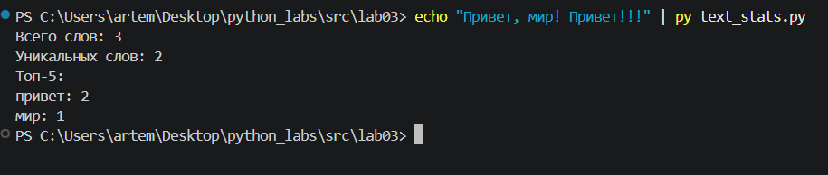

# Лабораторная работа №3
## Задание А
Реализуем функцию normalize  согласно требованиям. Для функции tokenize используем регулярные выражения, метод findall. Для top_n используем сортировку с помощью lambda-функции.
```python
def normalize(text: str, *, casefold: bool = True, yo2e: bool = True) -> str:
    try:
        type(text) == str
    except TypeError:
        print("Введите строку")    
    text = text.strip()
    if casefold == True:
        text = text.casefold()
    if yo2e == True:
        text = text.replace("ё", "е")
        text = text.replace("Ё", "Е")
    text = text.replace('/t', ' ')
    text = text.replace('/r', ' ')
    text = text.replace('/n', ' ')
    text = text.strip()
    text = ' '.join(x for x in text.split())
    return text

def tokenize(text: str) -> list[str]:
    try:
        type(text) == str
    except TypeError:
        print("Введите строку")
    text = normalize(text)
    import re
    tokens = re.findall(r"/w+(?:-/w+)*", text)
    return tokens

def count_freq(tokens: list[str]) -> dict[str, int]:
    try:
        type(tokens) == list
    except TypeError:
        print("Введите список")    
    st = sorted(set(tokens))
    res = {key: 0 for key in st}
    for val in tokens:
        res[val] += 1
    return res

def top_n(freq: dict[str, int], n: int = 5) -> list[tuple[str, int]]:
    sorted_items = sorted(freq.items(), key=lambda x: (-x[1],x[0]))
    return sorted_items[:n]
```

## Задание В
Вводим данные с помощью stdin, импортируем функции из файла text.py, затем выводим статистику по тексту.
```python
import sys
from pathlib import Path
current_dir = Path(__file__).resolve().parent
project_root = current_dir.parent.parent
lib_path = project_root / "src" / "lib"
sys.path.append(str(lib_path))
from text import normalize
from text import tokenize
from text import count_freq
from text import top_n
sys.stdin.reconfigure(encoding='utf-8')
sys.stdout.reconfigure(encoding='utf-8')
textos = sys.stdin.read()
k = 0
tokens = tokenize(textos)
total = len(tokens)
freqs = count_freq(tokens)
unique = len(freqs)
tierlist = top_n(freqs, 5)
print(f'Всего слов: {total}')
print(f'Уникальных слов: {unique}')
print('Топ-5:')
for word, frequency in tierlist:
    print(f'{word}: {frequency}')
```
