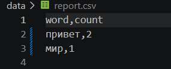
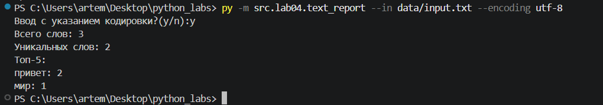
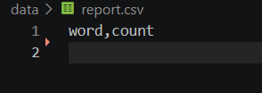
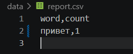

# Лабораторная работа №4
## Задание A
Функция read_text
```python
from pathlib import Path
from src.lib.text import normalize
def read_text(path: str | Path, encoding: str = "utf-8") -> str:
    p = Path(path)
    """FileNotFoundError - файл не найден
    UnicodeDecodeError - неверная кодировка
    Пример с другой кодировкой - encoding='cp1251'"""
    return normalize(p.read_text(encoding=encoding))
```
Функция write_csv
```python
import csv
from pathlib import Path
from typing import Iterable, Sequence

def write_csv(rows: Iterable[Sequence], path: str | Path,
              header: tuple[str, ...] | None = None) -> None:
    p = Path(path)
    rows = list(rows)
    with p.open("w", newline="", encoding="utf-8") as f:
        w = csv.writer(f)
        if header is not None:
            w.writerow(header)
        for r in rows:
            w.writerow(r)
```
Генерация отчета: функции frequencies_from_text и sorted_word_counts
```python
from collections import Counter

def frequencies_from_text(text: str) -> dict[str, int]:
    from src.lib.text import normalize, tokenize  # из ЛР3
    tokens = tokenize(normalize(text))
    return Counter(tokens)  # dict-like

def sorted_word_counts(freq: dict[str, int]) -> list[tuple[str, int]]:
    return sorted(freq.items(), key=lambda kv: (-kv[1], kv[0]))
```
## Задание В
Для распознавания кодировки используется библиотека argparse, флаг --in измененен, т.к. является недопустимым.
```python
from src.lab04.io_txt_csv import read_text, write_csv, sorted_word_counts, frequencies_from_text
from src.lib.text import *
from src.lib.text_stats import text_stats
import sys
file_input_path = "data/lab04/input.txt"
import argparse
is_arg_input = input('Ввод с указанием кодировки?(y/n):')
if is_arg_input == 'y':
    parser = argparse.ArgumentParser()
    parser.add_argument("--in", dest="input_file")
    parser.add_argument("--encoding", default='utf-8')
    args = parser.parse_args()
    file_read = read_text(args.input_file, args.encoding)
else:
    file_read = read_text(file_input_path)
freqs = [(key, value) for key, value in count_freq(tokenize(file_read)).items()]
freqs.sort(key=lambda x: (-x[1], x[0]))
write_csv(freqs, 'data/report.csv', ("word", "count"))
text_stats(file_read)
```
Для отчета в консоли использовалась функция text_stats:
```python
from src.lib.text import *
def text_stats(textos: str) -> str:
    tokens = tokenize(textos)
    total = len(tokens)
    freqs = count_freq(tokens)
    unique = len(freqs)
    tierlist = top_n(freqs, 5)
    print(f'Всего слов: {total}')
    print(f'Уникальных слов: {unique}')
    print('Топ-5:')
    for word, frequency in tierlist:
        print(f'{word}: {frequency}')
```
# Тест-кейсы
## A. Один файл (база)
Вход(```data/lab04/input.txt```):

```Привет, мир! Привет!!!```

Получаем report.csv:



Консоль:

## B. Пустой файл

Вход: пустой ```data/input.txt```

Файл report.csv содержит только заголовок:



## C. Кодировка cp1251

Вход содержит "Привет" в cp1251

Файл report.csv:

