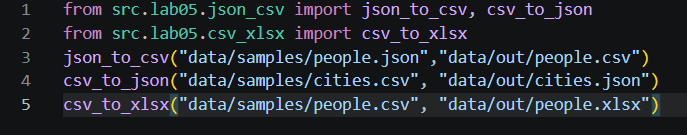
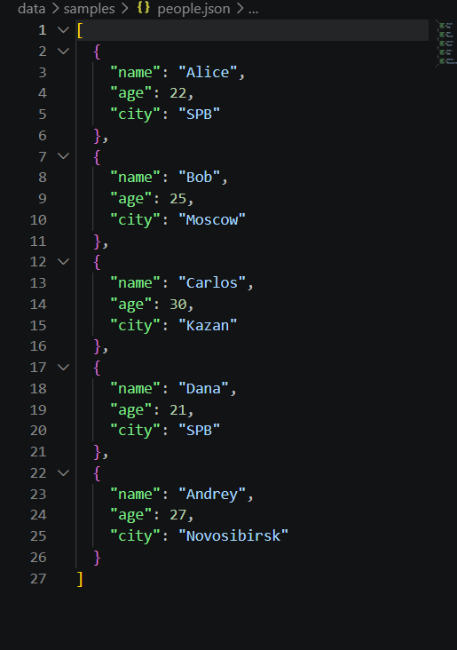
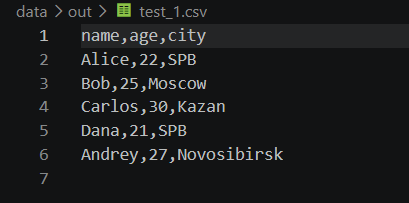
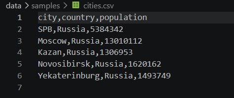
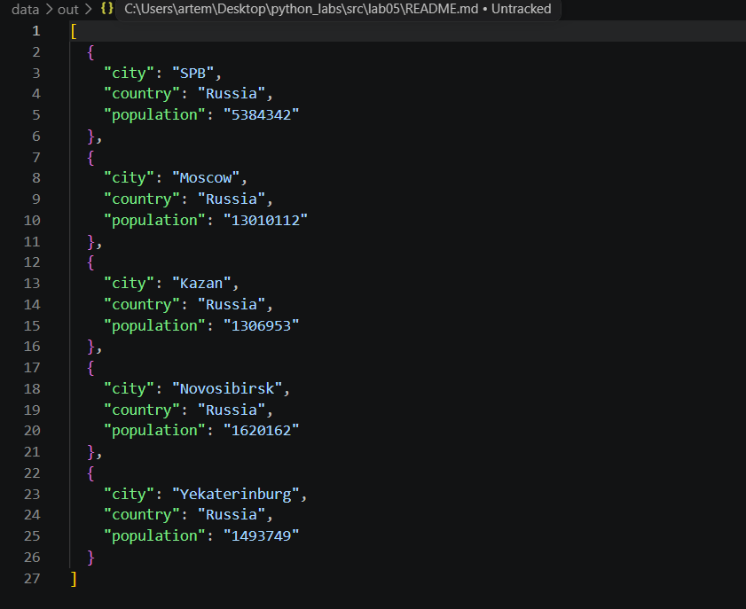
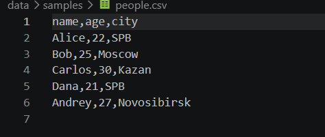
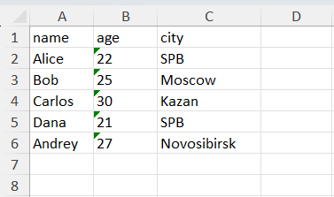

# Лабораторная работа №5
## Задание A
Проверяем тип файла, используем csv.DictWriter для записи в csv. Для записи в json используем json.dump(... indent=2, ensure_ascii=False)
```python
import json
import csv
from pathlib import Path
def json_to_csv(json_path: str, csv_path: str) -> None:
    """
    Преобразует JSON-файл в CSV.
    Поддерживает список словарей [{...}, {...}], заполняет отсутствующие поля пустыми строками.
    Кодировка UTF-8. Порядок колонок — как в первом объекте или алфавитный (указать в README).
    """    
    js_path = Path(json_path)
    c_path = Path(csv_path)
    if js_path.suffix != ".json":
        raise ValueError("Некорректное расширение json-файла")
    if c_path.suffix != ".csv":
        raise ValueError("Некорректное расширение csv-файла")
    try:
        with open(json_path, 'r', encoding='utf-8') as f:
            data = json.load(f)
    except json.JSONDecodeError:
        raise ValueError(f"Файл {json_path} пуст или содержит битый json")
    except FileNotFoundError:
        raise ValueError(f"Файл {json_path} не найден")
    if not data:
        raise ValueError(f"JSON пуст")
    if isinstance(data, dict):
        data = [data]
    fieldnames = data[0].keys()
    with open(csv_path, 'w', encoding='utf-8', newline="") as f:
        writer = csv.DictWriter(f, fieldnames=fieldnames)
        writer.writeheader()
        writer.writerows(data)

def csv_to_json(csv_path: str, json_path: str) -> None:
    """
    Преобразует CSV в JSON (список словарей).
    Заголовок обязателен, значения сохраняются как строки.
    json.dump(..., ensure_ascii=False, indent=2)
    """
    js_path = Path(json_path)
    c_path = Path(csv_path)
    if js_path.suffix != ".json":
        raise ValueError("Некорректное расширение json-файла")
    if c_path.suffix != ".csv":
        raise ValueError("Некорректное расширение csv-файла")
    if not Path.is_file(csv_path):
            raise FileNotFoundError("Файл не найден")
    if not Path.is_file(json_path):
            raise FileNotFoundError("Файл не найден")
    with open(csv_path, 'r', encoding="utf-8") as f:
        reader = csv.DictReader(f)
        if not reader.fieldnames:
            raise ValueError("Пустой заголовок")
        data = list(reader)
        if not data:
            raise ValueError("Пустой CSV файл")
    with open(json_path, 'w', encoding="utf-8") as f:
        json.dump(data, f, indent=2, ensure_ascii=False)
```
## Задание B
Устанавливаем библиотеку openpyxl и используем её для создания и заполнения xlsx-файла.
```python
import csv
from openpyxl import Workbook
from openpyxl.utils import get_column_letter
from pathlib import Path
def csv_to_xlsx(csv_path: str, xlsx_path: str) -> None:
    """
    Конвертирует CSV в XLSX.
    Использовать openpyxl ИЛИ xlsxwriter.
    Первая строка CSV — заголовок.
    Лист называется "Sheet1".
    Колонки — автоширина по длине текста (не менее 8 символов).
    """
    c_path = Path(csv_path)
    if c_path.suffix != ".csv":
        raise ValueError(f"Ожидался csv-файл, получен {c_path}")
    if not Path.is_file(csv_path):
        raise FileNotFoundError("Файл не найден")
    if not Path.is_file(xlsx_path):
            raise FileNotFoundError("Файл не найден")
    with open(csv_path, 'r', encoding='utf-8', newline='') as f:
        reader = csv.DictReader(f)
        data = [row for row in reader if row]
    if not data:
        raise ValueError("Пустой csv-файл")
    fieldnames = list(reader.fieldnames)
    wb = Workbook()
    ws = wb.active
    ws.title = "Sheet1"
    ws.append(fieldnames)
    for row in data:
        ws.append(list(row.values()))
    for col_idx in range(1, len(fieldnames) + 1):
        max_len = len(str(fieldnames[col_idx - 1]))
        for row in data:
            value = str(row[fieldnames[col_idx - 1]])
            max_len = max(max_len, len(value))
        ws.column_dimensions[get_column_letter(col_idx)].width = max(8, max_len + 2)

    wb.save(xlsx_path)
```
# Тест-кейсы
## Задание А
Для тестов создан test_script.py:



### json_to_csv() | people.json -> people.csv:
## in:
## out:


### csv_to_json() | cities.csv -> cities.json:
## in: 

## out: 

### csv_to_xlsx() | people.csv -> people.xlsx:

## in: 
## out: 

Как видно из данных, функции корректны