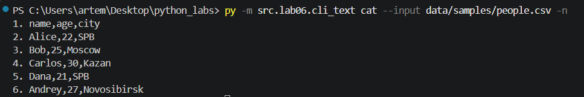
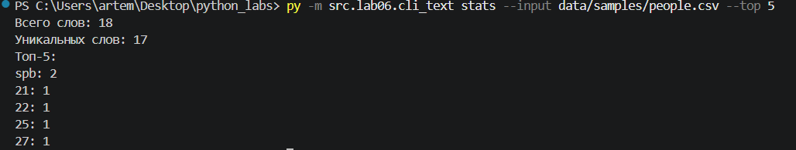
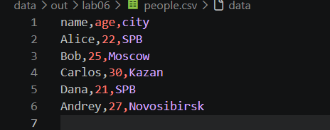
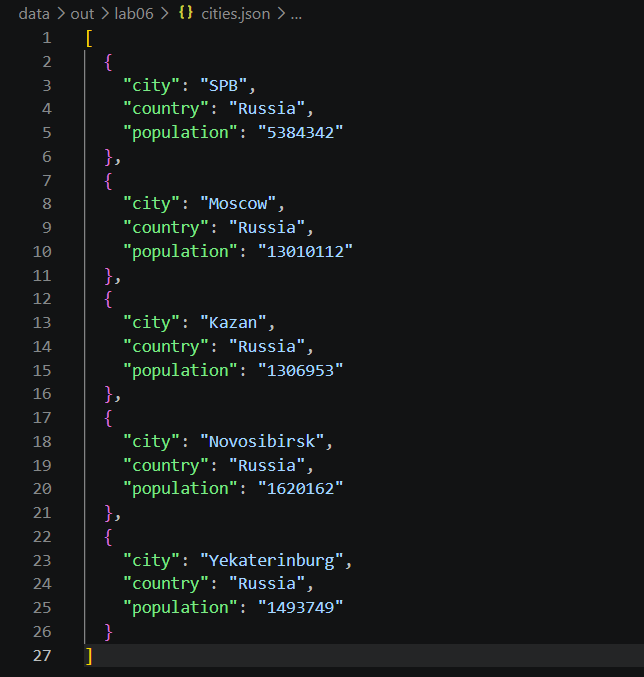
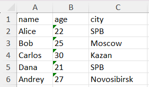
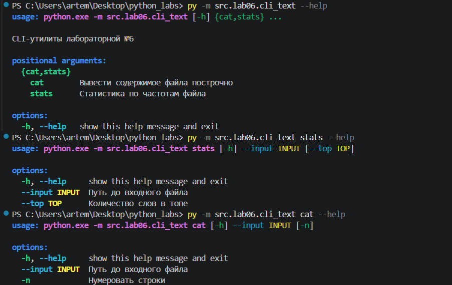
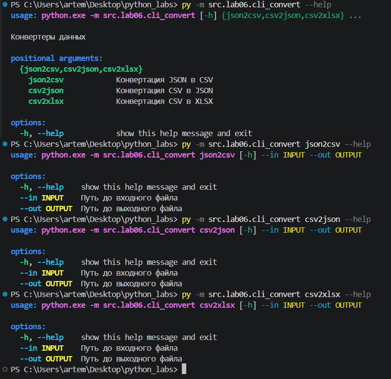

#  CLI‑утилиты с argparse
## Модуль ```src/lab06/cli_text.py```

Описываем help аргументов и подкоманд, обрабатываем исключения

```python
import argparse
from src.lib.text_stats import *
from pathlib import Path
def main():
    parser = argparse.ArgumentParser(description="CLI‑утилиты лабораторной №6")
    subparsers = parser.add_subparsers(dest="command")

    # подкоманда cat
    cat_parser = subparsers.add_parser("cat", help="Вывести содержимое файла построчно")
    cat_parser.add_argument("--input", type=str, required=True, help="Путь до входного файла")
    cat_parser.add_argument("-n", action="store_true", help="Нумеровать строки")

    # подкоманда stats
    stats_parser = subparsers.add_parser("stats", help="Статистика по частотам файла")
    stats_parser.add_argument("--input", type=str, required=True, help="Путь до входного файла")
    stats_parser.add_argument("--top", type=int, default=5, help="Количество слов в топе")

    args = parser.parse_args()

    try:
        if args.command == "cat":
            k = 0
            with open(args.input, 'r', encoding='utf-8') as f:
                for line in f:
                    k+=1
                    string = line.strip('\n')
                    if args.n == True:
                        print(f'{k}. {string}')
                    else:
                        print(line)
        elif args.command == "stats":
            data = ''
            with open(args.input, 'r', encoding='utf-8') as  f:
                for line in f:
                    data += line
            print(text_stats(data, args.top))
    except FileNotFoundError:
        print("Файл не найден")

if __name__ == "__main__":
    main()
```

## Модуль ```src/lab06/cli_convert.py```
Описываем help аргументов и подкоманд, обрабатываем исключения

```python
import argparse
from src.lab05.json_csv import json_to_csv, csv_to_json
from src.lab05.csv_xlsx import csv_to_xlsx

def main():
    parser = argparse.ArgumentParser(description="Конвертеры данных")
    sub = parser.add_subparsers(dest="cmd")

    p1 = sub.add_parser("json2csv", help="Конвертация JSON в CSV")
    p1.add_argument("--in", dest="input", required=True, help="Путь до входного файла")
    p1.add_argument("--out", dest="output", required=True, help="Путь до выходного файла")

    p2 = sub.add_parser("csv2json", help="Конвертация CSV в JSON")
    p2.add_argument("--in", dest="input", required=True, help="Путь до входного файла")
    p2.add_argument("--out", dest="output", required=True, help="Путь до выходного файла")

    p3 = sub.add_parser("csv2xlsx", help="Конвертация CSV в XLSX")
    p3.add_argument("--in", dest="input", required=True, help="Путь до входного файла")
    p3.add_argument("--out", dest="output", required=True, help="Путь до выходного файла")

    args = parser.parse_args()

    if args.cmd == 'json2csv':
        json_to_csv(args.input, args.output)
    elif args.cmd == 'csv2json':
        csv_to_json(args.input, args.output)
    elif args.cmd == 'csv2xlsx':
        csv_to_xlsx(args.input, args.output)

if __name__ == "__main__":
    main()
```

# Тест-кейсы
## Подкоманда cat:

### Ввод: ```data/samples/people.csv```

### Вывод: 


## Подкоманда stats:

### Ввод: ```data/samples/people.csv```

### Вывод: 


## Подкоманда json2csv:

### Ввод: ```data/sample/people.json```

### Вывод:


## Подкоманда csv2json:

### Ввод: ```data/sample/cities.csv```

### Вывод:


## Подкоманда csv2xlsx:

### Ввод: ```data/sample/people.csv```

### Вывод:


# Описание help

## Help в cli_text:



## Help в cli_convert:


