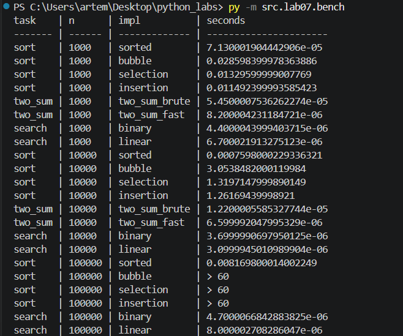

# Лабораторная работа №7
## Функции ```bubble_sort```, ```insertion_sort```, ```selection_sort```
```python
def bubble_sort(nums):
    new_nums = nums[:]
    len_list = len(new_nums)
    for i in range(len_list-1):
        swap = False
        for j in range(len_list - 1 - i):
            if new_nums[j] > new_nums[j+1]:
                new_nums[j], new_nums[j+1] = new_nums[j+1], new_nums[j]
                swap = True
        if not swap:
            break
    return new_nums

def insertion_sort(nums):
    n = len(nums)
    new_nums = nums[:]
    for i in range(1, n):
        key = new_nums[i]
        j = i - 1
        while j >= 0 and new_nums[j] > key:
            new_nums[j + 1] = new_nums[j]
            j -= 1
        new_nums[j + 1] = key
    return new_nums

def selection_sort(nums):
    new_nums = nums[:]
    n = len(new_nums)
    for i in range(n - 1):
        min_idx = i
        for j in range(i + 1, n):
            if new_nums[j] < new_nums[min_idx]:
                min_idx = j
        new_nums[i], new_nums[min_idx] = new_nums[min_idx], new_nums[i]
    return new_nums
```
## Функции ```linear_search```, ```binary_search```, ```two_sum_brute```, ```two_sum_fast```

```python
def linear_search(nums, x) -> int:
    """Индекс первого вхождения x или -1.
 
    linear_search([4, 2, 7, 2], 2) -> 1
    linear_search([4, 2, 7, 2], 9) -> -1
    linear_search([], 1) -> -1
    """
    for index in range(len(nums)):
        if nums[index] == x:
            return index
    return -1

def binary_search(nums: list[int], target: int) -> int:
    lo, hi = 0, len(nums) - 1
    while lo <= hi:
        mid = lo + (hi - lo) // 2
        if nums[mid] == target:
            return mid
        if nums[mid] < target:
            lo = mid + 1
        else:
            hi = mid - 1
    return -1

def two_sum_brute(nums, target) -> tuple[int, int] | None:
    for i in range(len(nums)):
        for j in range(i+1, len(nums)):
            summ = nums[i] + nums[j]
            if summ == target:
                return i, j

def two_sum_fast(nums, target) -> tuple[int, int] | None:
    seen = {}
    for i, x in enumerate(nums):
        need = target - x
        if need in seen:
            return seen[need], i
        seen[x] = i
```

## Проверка функций: ```check.py```
```python
import random
from src.lab07.sorting import bubble_sort, insertion_sort, selection_sort
from src.lab07.search import linear_search, binary_search, two_sum_brute, two_sum_fast
 
 
def check_sorting(fn, trials=100):
    for _ in range(trials):
        n = random.randint(0, 50)
        nums = [random.randint(-100, 100) for _ in range(n)]
        original = list(nums)
        result = fn(nums)
        assert result == sorted(nums), f"{fn.__name__} ошиблась на {nums}: {result}"
        assert nums == original, f"{fn.__name__} изменила исходный список"
 
def check_search(fn, trials=100):
    for _ in range(trials):
        n = random.randint(0, 50)
        nums = sorted([random.randint(-100, 100) for _ in range(n)])
        if not nums:
            continue
        x = random.choice(nums)
        original = list(nums)
        result = fn(nums, x)
        assert original[result] == original[original.index(x)], \
            f"{fn.__name__} ошиблась на {original}: {result}, элемент:{x}, ожидалось:{original.index(x)}"

def check_two_sum(trials=100):
    for _ in range(trials):
        n = random.randint(2, 50)
        original = [random.randint(-100, 100) for _ in range(n)]
        x = random.randint(-200, 200)
        result_brute = two_sum_brute(original, x)
        result_fast = two_sum_fast(original, x)
        if result_fast and result_brute:
            assert sum([original[i] for i in result_brute]) == sum([original[i] for i in result_fast]) == x, f"Одна из функций ошиблась:\nbrute: {result_brute}\nfast:{result_fast}\n data: {original}, {x}"
        else:
            assert result_brute == result_fast == None
        
if __name__ == "__main__":
    random.seed(42)
    for fn in (bubble_sort, insertion_sort, selection_sort):
        check_sorting(fn)
    for fn in (linear_search, binary_search):
        check_search(fn)
    check_two_sum()
    print("OK")
```

Результат проверки:
 
## Таблица в терминале



Таблица [bench.csv](bench.csv) с результатами работы

## Вывод
Посмотрим как увеличивается время каждого алгоритма:
sorted: 0.00007(n=1000) -> 0.0007(n=10000) -> 0.008(n=100000)

bubble: 0.029(n=1000) -> 3.054(n=10000) -> >60(n=100000)

selection: 0.013(n=1000) -> 1.319(n=10000) -> >60(n=100000)

insertion: 0.011(n=1000) -> 1.262(n=10000) -> >60(n=100000)

two_sum_brute: 0,00005(n=1000) -> 0.00001(n=10000)

two_sum_fast: 0,000008(n=1000) -> 0.00006(n=10000)

linear_search: 0.000006(n=1000) -> 0.000003(n=10000) -> 0.000008(n=100000)

binary_search: 0,000004(n=1000) -> 0,000003(n=10000) -> 0.000006(n=100000)

sorted растет примерно как $O(n log n)$

bubble, selection, insertion - как $O(n^2)$

В ходе тестирования алгоритмов сортировки на массивах размером 10 000 и 100 000 элементов было выявлено значительное различие в производительности. Квадратичные алгоритмы (bubble sort, selection sort) демонстрируют критическое увеличение времени выполнения при росте объёма данных: на массиве в 100 000 элементов они не укладываются в лимит в 60 секунд.

Встроенная функция ```sorted()```  показывает наилучшие результаты, работая на два-три порядка быстрее остальных реализаций.